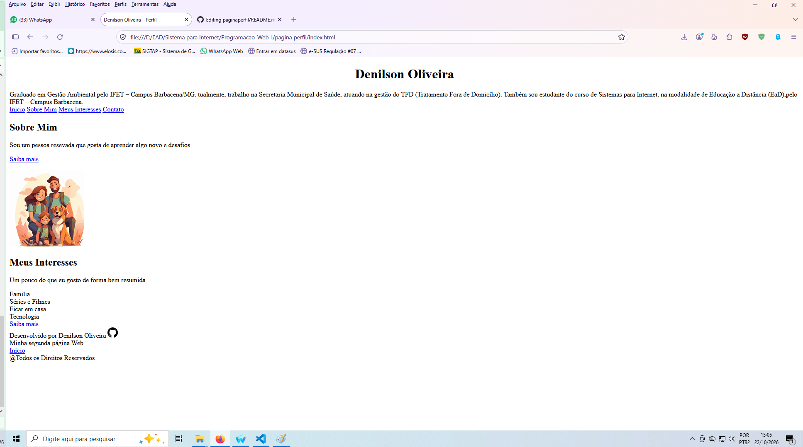
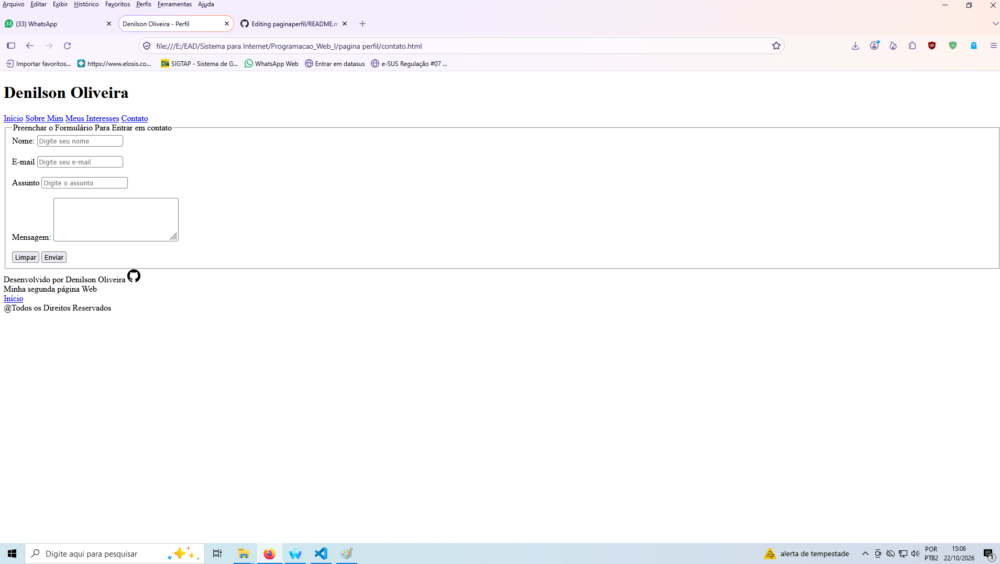
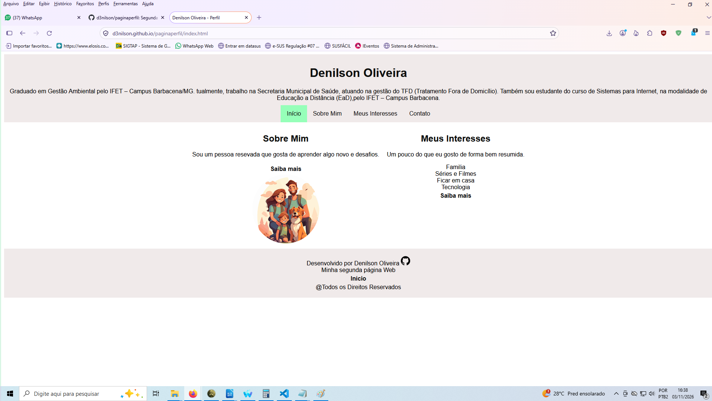
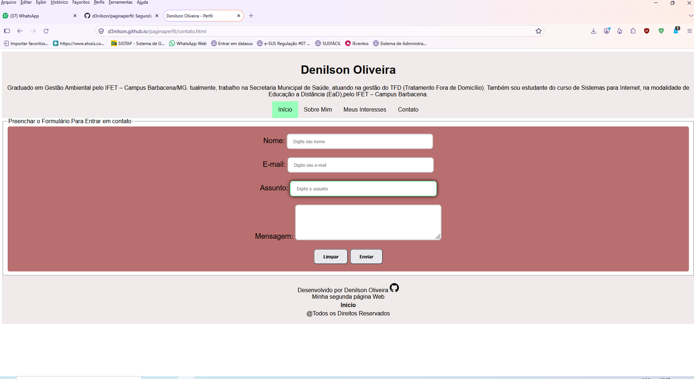

HTML
# Minha segunda página Web
Nome: Denilson da Silva Oliveira
## Sobre a atividade
Responsividade da página ( atividade 6)
Programação Web.
## Tecnologias utilizadas
- HTML
- Git
- GitHub
## Captura das Evidências

